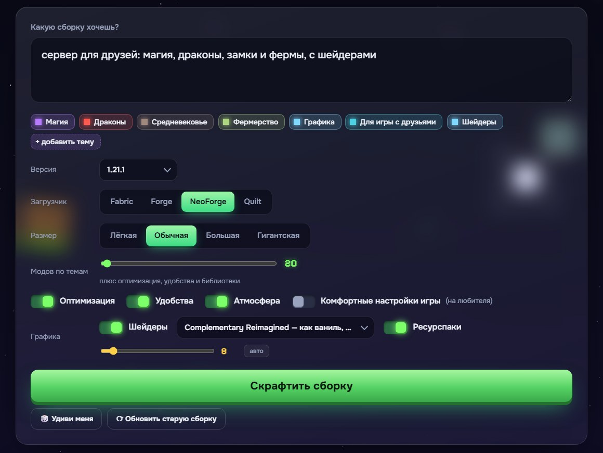
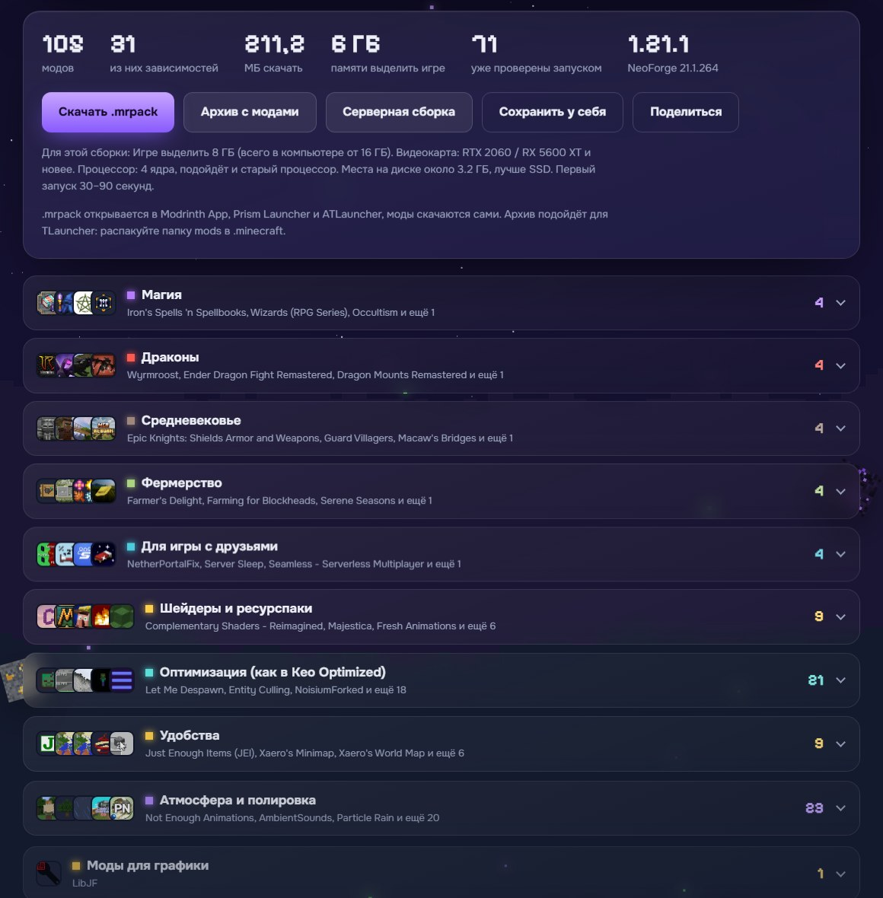
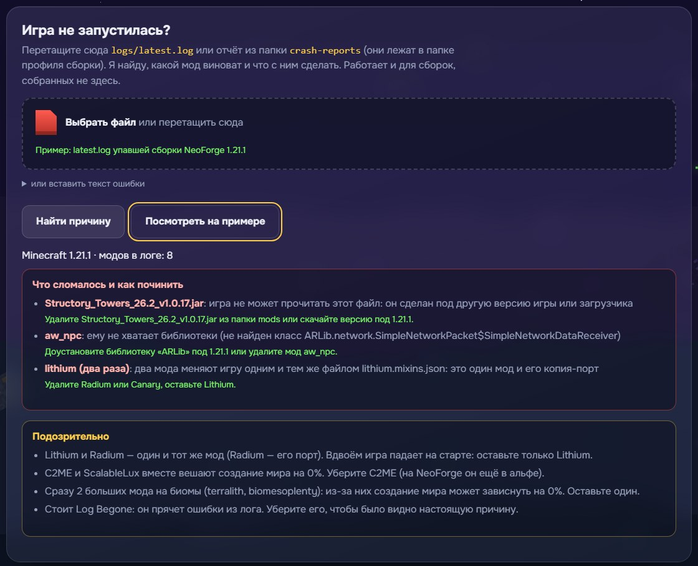

<h1 align="center">Modsmith</h1>

Опиши сборку мечты словами, и сайт соберёт совместимый модпак Minecraft. 
<b><a href="https://askjjkk.github.io/modsmith/">askjjkk.github.io/modsmith</a></b>

## Как это работает

1. Пишешь, что хочешь: «хардкорное выживание с магией и драконами на 1.20.1 forge».
2. Сайт прямо по ходу набора узнаёт темы (магия, драконы, хардкор…), версию и загрузчик.
3. «Скрафтить сборку»: моды влетают в верстак, а через 10–20 секунд готов список.
4. Скачиваешь **.mrpack** (Modrinth App, Prism Launcher, ATLauncher), **zip с .jar** для папки `mods` (TLauncher) или **серверную сборку** со `start.bat`, который сам скачает ядро сервера. Пока листаешь список, кнопки скачивания всегда под рукой на плавающей панели.

## Размер: от 5 до 1000 модов

Четыре пресета («Лёгкая» 8 тематических модов, «Обычная» 20, «Большая» 45, «Гигантская» 300) и ползунок на любое число до 1000. Сверху всегда идут оптимизация, удобства и библиотеки. Если тем не хватает на нужное число, сайт добирает популярное из подходящих категорий Modrinth, не нарушая запретов вроде «без хоррора». В запросе число можно написать словами: «гигантская сборка», «сотни модов», «500 модов». Пресеты «Гигантская» (437 модов на NeoForge, 431 на Fabric) проверены запуском: сервер создал мир. Выше ~400 модов запуск уже не гарантирован: проба на 866 модов не прошла (слишком много конфликтов), поэтому сайт предупреждает о риске, а «Доктор» по latest.log скажет, что именно не так.

## Почему сборка запускается

- Для каждого мода берётся файл именно под выбранные версию Minecraft и загрузчик (Fabric, Forge, NeoForge, Quilt).
- Обязательные зависимости (Fabric API, Architectury, GeckoLib, Curios…) подтягиваются сами, по цепочке.
- Моды, которые объявляют несовместимость друг с другом, вместе не попадают.
- Из похожих модов остаётся один: одна мини-карта, один просмотрщик рецептов, один движок рендера.
- **Проверка «что внутри».** Авторы модов не всегда указывают зависимости на Modrinth, поэтому Modsmith заглядывает в каждый .jar (`fabric.mod.json`, `quilt.mod.json`, `mods.toml`) и читает настоящий список. Файл целиком не качается: по HTTP Range берётся только оглавление архива и нужная запись. Недостающую библиотеку сайт ищет и добавляет, а если её нет, убирает мод, которому она нужна.
- Все моды в `.mrpack` помечены как нужные на клиенте: в одиночной игре серверные библиотеки тоже должны стоять.
- **Версия игры по самому файлу.** На Modrinth бывают файлы, помеченные как подходящие для 1.21.1, хотя собраны под 1.21.5 или 26.2. Сайт сверяет версию в имени файла и в описании внутри .jar (`minecraft`-диапазон, строка `modLoader`) и берёт подходящую версию мода. Файлы только для другого загрузчика тоже отсеиваются.
- **Двойники и конфликты.** Два мода, которые встраиваются в игру одним и тем же mixin-файлом (Lithium и его порт Radium), вместе не попадают. Несовместимость, которую автор объявил в самом .jar (`breaks`, `incompatible`), учитывается с диапазоном версий: если конфликт только со старой версией, сайт ставит новую (Sodium 0.8.13 и Iris 1.8.13), а не выкидывает мод.
- **Группы «только один»:** один большой мод на биомы (Terralith, Biomes O' Plenty, Oh The Biomes We've Gone…), одна замена каждой постройки (две «улучшенные пустынные пирамиды» дерутся), один мод на рельеф.
- **Дополнения.** Лёгкую основу дополнения (Farmer's Delight) сайт добавит сам, тяжёлую (Create, Cobblemon) ради одного дополнения тащить не будет.
- **Версии библиотек.** Если библиотека нужна только одному моду, ставится та её версия, под которую он сделан; диапазоны версий из .jar проверяются так же мягко, как это делает сама игра.
- Если подходящего файла или зависимости нет, мод не попадает в сборку и показывается в списке «Что я отсеял и почему», сгруппированном по причинам.
- Сверху всегда идёт база: оптимизация (Sodium или Embeddium, FerriteCore, ModernFix…) и удобства (JEI, карта Xaero, AppleSkin, Jade). Её можно выключить.

**Проверка запуском с созданием мира.** `tools/mass_check.py` поднимает настоящий сервер (Fabric, Quilt, Forge, NeoForge) для каждой тестовой сборки, создаёт мир и ждёт «Done». Падение при запуске или при генерации мира разбирается автоматически (crash-report, стек, «has failed to load correctly», дубли пакетов), виновник убирается, и сервер запускается снова; зависание создания мира ловится по таймауту со снимком потоков. Если сборка не печатает «Done», сервер считается рабочим только по снимку потоков (главный поток ждёт такта). Найденное уходит в `js/broken.js`: общий чёрный список, запреты для отдельного загрузчика (`platform@forge`) и моды «только для игры», которые не ставятся на сервер.

Раньше проверено на пяти сборках (Forge 1.20.1, NeoForge 1.21.1, Fabric 26.3 и 1.21.1, Quilt 1.20.1): у каждого мода на месте все зависимости и по данным Modrinth, и по метаданным внутри .jar, конфликтов нет, все файлы скачиваются, и контрольные суммы SHA-1 совпадают с .mrpack.

## Оптимизация как в лучших сборках

Базу оптимизации сайт не выдумывает, а берёт из свежей версии проверенных сборок под выбранную версию игры:

- **Fabric / Quilt** — состав и конфиги [Fabulously Optimized](https://modrinth.com/modpack/fabulously-optimized) (BSD-3-Clause, © Fabulously Optimized contributors) плюс моды для быстрой прогрузки чанков: C2ME, Noisium, ScalableLux, BadOptimizations;
- **Forge / NeoForge** — состав и конфиги [Keo Optimized](https://modrinth.com/modpack/keo-optimized) (CC0), но без того, что ломало настоящие сборки: на NeoForge не берутся альфа-версия C2ME и ScalableLux (мир висел на 0%) и Saturn, а Log Begone не берётся нигде (прячет ошибки из лога).

Конфиги этих сборок кладутся в `overrides/config/` вместе с файлом `config/modsmith-credits.txt`. Если эталона под версию нет, используется свой проверенный список.

## Ресурспаки, шейдеры, голосовой чат

Раздел «Графика» сам подбирает **ресурспаки** под темы и размер сборки: 3 для лёгкой, 8 для обычной, 20 для большой, 40 для гигантской и до 100 на максимуме. Берутся подходящие по темам, лёгкие дополнения сверху и только один «тяжёлый» пак, который перерисовывает почти всё, чтобы они не воевали друг с другом. Паки для конкретных модов (Cobblemon и др.) попадают, только если такой мод в сборке есть. Шейдеров кладётся от 1 до 10; включён будет выбранный, остальные можно переключить в игре. Если в запросе есть «сервер», в сборку сам ставится **Simple Voice Chat**.

## Графика

Раздел «Графика»: шейдеры (MakeUp для слабых ПК, Complementary, BSL, Photon, Bliss) и ресурспаки (Fresh Animations, Better Leaves и другие). Сайт сам ставит Iris или Oculus и моды, без которых ресурспак не работает, а через `config/iris.properties` и `options.txt` включает выбранное в игре. «С шейдерами», «красивая графика», «для слабого пк» в описании тоже понимаются.

## Ещё

- **Мои сборки.** Кнопка «Сохранить у себя» запоминает сборку в браузере, потом её можно открыть из списка под кнопкой «Скрафтить».
- **Требования к ПК.** Под кнопками скачивания пишется, сколько ОЗУ выделить игре, какая нужна видеокарта и процессор для этой сборки.
- **Обновить старую сборку.** Загрузите свой .mrpack, и сайт перенесёт его моды на выбранную версию игры и загрузчик: что не вышло под новую версию, попадёт в список отсеянного с причиной.
- **Удиви меня.** Случайная сборка из 3–5 тем.

## Комфортные настройки

Переключатель «Комфортные настройки игры (на любителя)» кладёт в сборку готовый `options.txt` (дальность прорисовки 32, FPS до 260, без покачивания камеры, русский язык, подсказки к предметам). В `.mrpack` он лежит в `overrides/`, лаунчер применит его сам.

## Если игра всё-таки не запустилась

«Доктор сборки» всегда внизу страницы: перетащите `logs/latest.log` или файл из `crash-reports` (или вставьте текст). Он работает и для сборок, собранных не здесь: список модов и версию игры берёт из самого лога. Понимает недостающие зависимости, мод не под ту версию игры («not a valid mod file», «Missing ModLoader»), нехватку библиотеки (NoClassDefFoundError при создании мода), двойников с одним mixin-файлом, дубли модов и пакетов, клиентский мод на сервере, не ту Java и нехватку памяти, а если явной ошибки нет, показывает подозрительное: опасные пары модов, несколько модов на биомы, Log Begone. Для сборки с сайта сразу убирает виновников и отдаёт исправленный `.mrpack`. Кнопка «Посмотреть на примере» (или ссылка с `#doctor-example`) показывает разбор на логе настоящей упавшей сборки.

Моды, которые падали при наших проверках запуском, лежат в общем чёрном списке (`js/broken.js`) и не попадают ни в чью сборку. Список пополняет `tools/mass_check.py`: он собирает популярные запросы, запускает каждую сборку на сервере Fabric, сам находит упавшие моды, убирает их и повторяет, пока сервер не стартует.

## Что понимает

Больше 1000 тем: ~500 написаны вручную, ещё ~130 слов из словаря превращены в обычные темы, и ещё ~390 тем — самые популярные моды Modrinth по названию («хочу Create», «с Cobblemon»). Почти 400 из них — основные (у главных — список лучших модов, которые сайт пробует первыми: Iron's Spells, Create, Mekanism, Ice and Fire…), а всё, чего нет среди тем, ищется по словарю из ~500 слов про Minecraft с переводом (вертолёты, ниндзя, капибары, маяки…): по такому слову сайт создаёт тему «на лету» и ищет моды на Modrinth. Тем на русском и английском со словоформами и терпимостью к опечаткам («хачу харкор» тоже поймёт): от магии, драконов и техники до стимпанка, викингов, рыбалки, поездов, киберпанка и «для слабого ПК». Понимает отрицания («без магии», «не хочу хоррор», «no zombies») около 35 отсылок к играм и фильмам («как в Скайриме», Террария, Ведьмак, Сталкер, Stardew Valley, Factorio) и ~40 типовых фраз, которые меняют и настройки сборки: «для слабого пк», «для новичка», «для ребёнка», «с другом», «как ванилла, но лучше», «только оптимизация». Если по узкой теме под выбранную версию модов нет, сайт так и скажет. Перед сборкой показывает, как понял запрос: любую тему можно переключить кликом (хочу → не хочу → убрать) или добавить вручную. Без платного ИИ: свой словарь и поиск Modrinth.

У модов, которые уже прошли нашу проверку запуском, на карточке стоит значок «✓ проверен запуском» (список собирает `tools/make_verified.py`). Любой тематический мод можно заменить кнопкой «↻» на похожий: сайт сам подберёт замену той же темы и проверит её зависимости и совместимость.

Выбор тем вручную — в окне «+ добавить тему» с поиском и разделами: нажал, тема добавилась, окно осталось на месте.

Внизу экрана живёт питомец — пиксельный котик (или лисёнок, аксолотль, пчёлка): его можно таскать, тыкать, у него есть эмоции, а ещё у него можно спросить, как пользоваться сайтом.

Слова «лёгкая» и «огромная» меняют размер сборки, версия (`1.20.1`, `26.3`) и загрузчик (`forge`, `фабрик`) тоже читаются из текста. Ссылкой «Поделиться» можно отправить другу ту же сборку.

## Устройство

Чистые HTML, CSS и JavaScript без сборки и фреймворков, всё работает в браузере.

| Файл | Что делает |
|---|---|
| `js/themes.js` | словарь тем, база модов, взаимоисключающие группы |
| `js/parser.js` | разбор описания: темы, версия, загрузчик, размер |
| `js/modrinth.js` | клиент Modrinth API: кэш, не больше 6 запросов разом, повтор при лимите |
| `js/builder.js` | подбор: ранжирование, версии, зависимости, конфликты |
| `js/jarmeta.js` | чтение `fabric.mod.json`, `mods.toml`, `MANIFEST.MF` из .jar по кусочкам |
| `js/versions.js` | диапазоны версий Maven и Fabric, версия игры в имени файла |
| `js/dictionary.js` | словарь «русское слово → английский запрос» для тем «на лету» |
| `js/graphics.js` | шейдеры и ресурспаки |
| `js/doctor.js` | разбор crash-report и latest.log |
| `js/mrpack.js` | `.mrpack`, zip с модами и серверная сборка |
| `js/pet.js` | питомец |
| `js/ui.js`, `js/bg.js`, `js/textures.js` | интерфейс, ночное небо с параллаксом, пиксельные 3D-блоки |

Тесты: запустите любой локальный сервер (`py -m http.server`) и откройте `tests.html`.

## Лицензия

MIT. Моды принадлежат их авторам и скачиваются напрямую с Modrinth. Не связано с Mojang и Microsoft.
