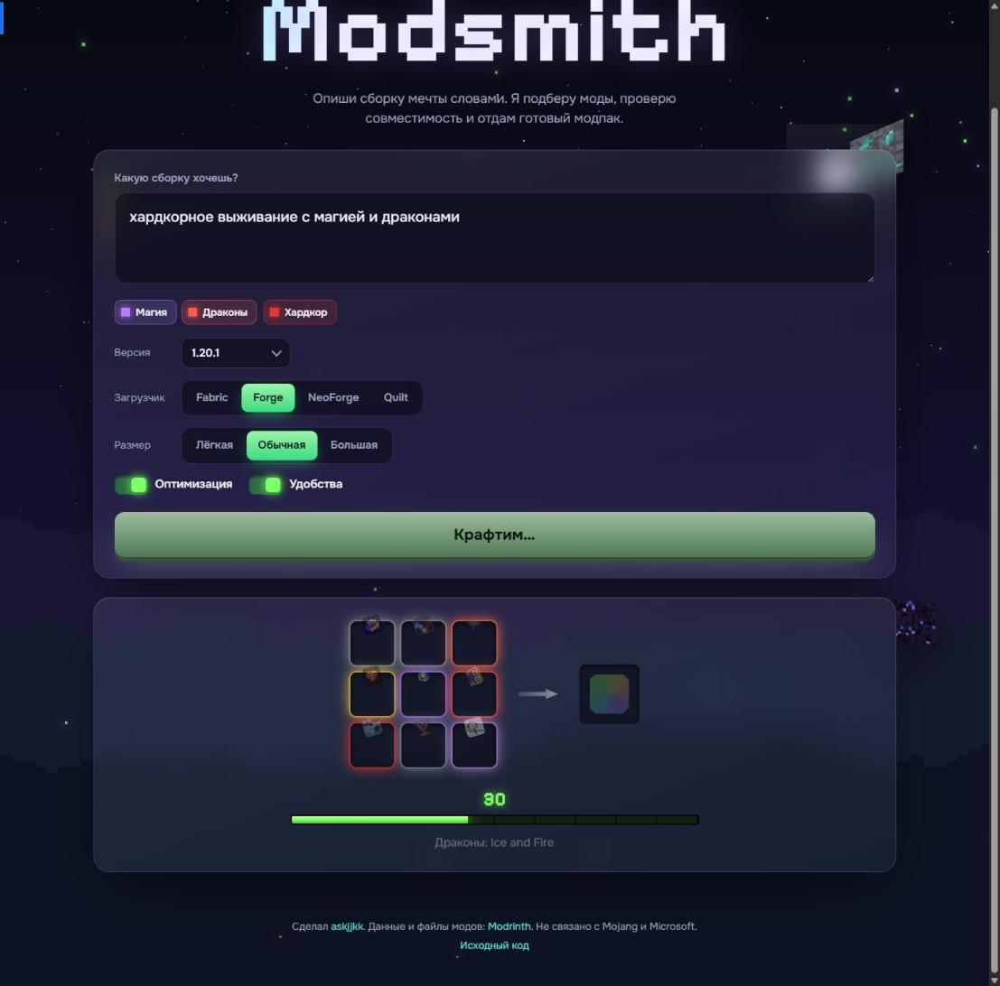

<h1 align="center">Modsmith</h1>

Опиши сборку мечты словами, и сайт соберёт совместимый модпак Minecraft. 
<b><a href="https://askjjkk.github.io/modsmith/">askjjkk.github.io/modsmith</a></b>

## Как это работает

1. Пишешь, что хочешь: «хардкорное выживание с магией и драконами на 1.20.1 forge».
2. Сайт прямо по ходу набора узнаёт темы (магия, драконы, хардкор…), версию и загрузчик.
3. «Скрафтить сборку»: моды влетают в верстак, а через 10–20 секунд готов список.
4. Скачиваешь **.mrpack** (Modrinth App, Prism Launcher, ATLauncher) или **zip с .jar** для папки `mods` (TLauncher).

## Почему сборка запускается

- Для каждого мода берётся файл именно под выбранные версию Minecraft и загрузчик (Fabric, Forge, NeoForge, Quilt).
- Обязательные зависимости (Fabric API, Architectury, GeckoLib, Curios…) подтягиваются сами, по цепочке.
- Моды, которые объявляют несовместимость друг с другом, вместе не попадают.
- Из похожих модов остаётся один: одна мини-карта, один просмотрщик рецептов, один движок рендера.
- **Проверка «что внутри».** Авторы модов не всегда указывают зависимости на Modrinth, поэтому Modsmith заглядывает в каждый .jar (`fabric.mod.json`, `quilt.mod.json`, `mods.toml`) и читает настоящий список. Файл целиком не качается: по HTTP Range берётся только оглавление архива и нужная запись. Недостающую библиотеку сайт ищет и добавляет, а если её нет, убирает мод, которому она нужна.
- Все моды в `.mrpack` помечены как нужные на клиенте: в одиночной игре серверные библиотеки тоже должны стоять.
- Если подходящего файла или зависимости нет, мод не попадает в сборку и показывается в списке «Не подошли».
- Сверху всегда идёт база: оптимизация (Sodium или Embeddium, FerriteCore, ModernFix…) и удобства (JEI, карта Xaero, AppleSkin, Jade). Её можно выключить.

Проверено на пяти сборках (Forge 1.20.1, NeoForge 1.21.1, Fabric 26.3 и 1.21.1, Quilt 1.20.1): у каждого мода на месте все зависимости и по данным Modrinth, и по метаданным внутри .jar, конфликтов нет, все файлы скачиваются, и контрольные суммы SHA-1 совпадают с .mrpack.

## Что понимает

Около 40 тем на русском и английском, со словоформами: магия, технологии, автоматизация, энергия, драконы, мобы, животные, динозавры, боссы, данжи, приключения, RPG, бои, броня, оружие, хардкор, хоррор, зомби, генерация мира, пещеры, моря и пираты, космос, измерения, средневековье, фэнтези, строительство, декор, еда, фермерство, сезоны, хранение, инвентарь, транспорт, телепорты, экономика, квесты, графика, звук, добыча, покемоны. Без платного ИИ: свой словарь и поиск Modrinth.

Слова «лёгкая» и «огромная» меняют размер сборки, версия (`1.20.1`, `26.3`) и загрузчик (`forge`, `фабрик`) тоже читаются из текста. Ссылкой «Поделиться» можно отправить другу ту же сборку.

## Устройство

Чистые HTML, CSS и JavaScript без сборки и фреймворков, всё работает в браузере.

| Файл | Что делает |
|---|---|
| `js/themes.js` | словарь тем, база модов, взаимоисключающие группы |
| `js/parser.js` | разбор описания: темы, версия, загрузчик, размер |
| `js/modrinth.js` | клиент Modrinth API: кэш, не больше 6 запросов разом, повтор при лимите |
| `js/builder.js` | подбор: ранжирование, версии, зависимости, конфликты |
| `js/jarmeta.js` | чтение `fabric.mod.json` и `mods.toml` из .jar по кусочкам |
| `js/mrpack.js` | `.mrpack` и zip с модами |
| `js/ui.js`, `js/bg.js`, `js/textures.js` | интерфейс, ночное небо с параллаксом, пиксельные 3D-блоки |

Тесты: запустите любой локальный сервер (`py -m http.server`) и откройте `tests.html`.

## Лицензия

MIT. Моды принадлежат их авторам и скачиваются напрямую с Modrinth. Не связано с Mojang и Microsoft.
